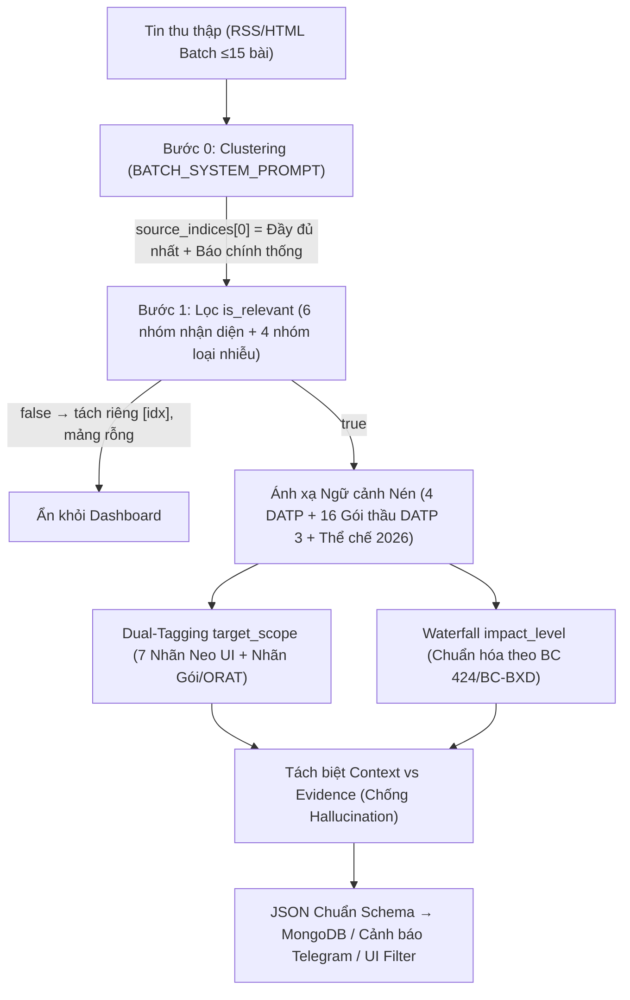

# Phân tích Chuyên sâu & Định hướng Tối ưu hóa `prompts.py` cho Hệ thống LTIA Radar (Cập nhật Thực trạng Tháng 11/2026)

> **Trạng thái tài liệu**: Bản phân tích kỹ thuật & thiết kế Prompt v2.0 (`ai_draft` — phục vụ rà soát và triển khai kỹ thuật).
> **Tệp mã nguồn hoàn chỉnh sẵn sàng triển khai**: [`prompts.py`](file:///c:/Clouds/LTIA/OneDrive%20-%20Airports%20Corporation%20of%20Vietnam%20-%20ACV/LTIA/01%20KTCN-MT/XD,%20c%E1%BA%ADp%20nh%E1%BA%ADt%20c%C3%A1c%20t%C3%A0i%20li%E1%BB%87u%20c%E1%BB%A7a%20ph%C3%B2ng%20KTCNMT/_OUTPUTS_SAN_PHAM/01_bao_cao_chuyen_mon/prompts.py)

---

## 1. Chẩn đoán 6 Điểm mù & Lỗi Kỹ thuật trong `prompts.py` Hiện hữu (và Spec Dự thảo)

Qua đối chiếu mã nguồn [`prompts.py`](file:///C:/Users/vuhuy/.gemini/antigravity/brain/a14d61eb-204a-4085-b176-14242c270215/.user_uploaded/media_1793785268493_60868234.py), tài liệu đặc tả [`PROMPT_ENGINEERING_SPEC.md`](file:///C:/Users/vuhuy/.gemini/antigravity/brain/a14d61eb-204a-4085-b176-14242c270215/.user_uploaded/media_1793785197459_2a1b9364.md), hồ sơ **Báo cáo số 424/BC-BXD ngày 27/10/2026 của Bộ Xây dựng** (`[CĂN CỨ PHÁP LUẬT CHUNG]`, trang 1–18 & Phụ lục 1–3) và hệ thống Quy chế của ACV (`[CĂN CỨ PHÁP LUẬT CHUNG]`), bộ prompt đang chạy bộc lộ **6 hạn chế cốt lõi** làm giảm chất lượng phân tích của LLM:

### 1.1. Lệch pha nghiêm trọng về Giai đoạn Dự án & Trọng tâm Rủi ro (Temporal Drift)
- **Hiện trạng trong `prompts.py` cũ (dòng 38–50)**: Vẫn neo cứng ở bối cảnh năm 2024 – đầu 2025: ghi `Mốc khánh thành: 02/09/2026`, chỉ liệt kê vỏn vẹn **02 gói thầu** (`5.10` và `4.6`), lấy *"thiếu cát san lấp"* làm ví dụ mẫu số 1 cho cả chế độ đơn lẻ lẫn Batch.
- **Thực tế tại tháng 11/2026** (theo Báo cáo `424/BC-BXD` ngày 27/10/2026, tr. 2–15):
  - Mốc `02/09/2026` đã đi qua; Gói thầu `3.4` (san nền và thoát nước) **đã hoàn thành** cùng `2.4`, `5.6`, `6.12`.
  - Tâm điểm điều hành hiện nay là **phương án đưa Cảng vào khai thác thương mại từ ngày `24/12/2026`** do ACV đề xuất (công bố tin tức hàng không AIRAC ngày `12/11/2026`) và quan điểm của Bộ Xây dựng: **không đánh đổi an toàn, an ninh, chất lượng để chạy theo tiến độ**, cảnh báo rủi ro **vừa khai thác vừa thi công hoàn thiện**.
  - Rủi ro đường găng thực sự hiện nằm ở **04/16 gói thầu của DATP 3 có nguy cơ không hoàn thành 100% trong tháng 12/2026** (`4.8`, `5.10`, `7.8`, `11.5`), áp lực nén thời gian **vận hành thử ORAT** (~3 tháng, 55 kịch bản), **chuỗi thủ tục nghiệm thu – cấp phép liên ngành tháng 11–12/2026**, và **lộ trình 3 bước chuyển đổi đường bay quốc tế từ Tân Sơn Nhất sang Long Thành**.

### 1.2. Thiếu hụt Bức tranh Thể chế 2025–2026 & Vai trò Kép của ACV – Cảng HKQT Long Thành
- **Thay đổi thể chế nhà nước (`[CĂN CỨ PHÁP LUẬT CHUNG]`, BC `424/BC-BXD` tr. 1, 7, 9, 16–18)**:
  - **Bộ Xây dựng** (sau hợp nhất với Bộ GTVT) là cơ quan chủ quản cả lĩnh vực xây dựng lẫn hàng không dân dụng (chỉ đạo trực tiếp **Cục Hàng không Việt Nam**, **Cục Giám định nhà nước về chất lượng CTXD**, **Cục Đăng kiểm Việt Nam**). Prompt cũ vẫn mặc định chỉ biết `"Bộ GTVT"`.
  - **Bộ Tài chính** là cơ quan đại diện chủ sở hữu vốn nhà nước tại ACV (thể hiện trực tiếp trên tiêu đề Quyết định `175/QĐ-HĐQT` ngày 26/03/2026).
  - **Bộ Công an (Cục Quản lý xuất nhập cảnh – Cục A08)** là cơ quan quản lý nhà nước và phê duyệt **An ninh hàng không** (Chương trình ANHK, Kế hoạch khẩn nguy, thẻ/giấy phép kiểm soát an ninh theo Thông tư `31/2025/TT-BCA` và `14/2026/TT-BCA`).
  - **Bộ Nông nghiệp và Môi trường** thẩm định và cấp **Giấy phép môi trường**.
- **Khoảng trống về ACV và Cảng HKQT Long Thành (LTIA)**:
  - Prompt cũ chỉ coi ACV là *"Chủ đầu tư"* xây dựng mà chưa phân biệt **vai trò kép** của ACV:
    1. **Chủ đầu tư DATP 3** qua **Ban Quản lý dự án Cảng HKQT Long Thành (Ban QLDA Long Thành)**.
    2. **Người khai thác cảng (Airport Operator)** qua **Cảng HKQT Long Thành (LTIA)** — Chi nhánh cấp 1 trực thuộc ACV thành lập theo Quyết định `452/QĐ-HĐQT` (08/9/2025), vận hành theo Quy chế `175/QĐ-HĐQT` (26/03/2026) (`[CĂN CỨ PHÁP LUẬT CHUNG]`, trang 3–6) gồm Ban Giám đốc, 08 Phòng/Văn phòng chuyên môn (trong đó có Phòng KTCN-MT, Phòng An toàn - KSCL — đối chiếu `[DỰ ÁN CỤC BỘ]` [`20261008 Danh sach he thong trang thiet bi cong trinh.docx`](file:///c:/Clouds/LTIA/OneDrive%20-%20Airports%20Corporation%20of%20Vietnam%20-%20ACV/LTIA/01%20KTCN-MT/XD,%20c%E1%BA%ADp%20nh%E1%BA%ADt%20c%C3%A1c%20t%C3%A0i%20li%E1%BB%87u%20c%E1%BB%A7a%20ph%C3%B2ng%20KTCNMT/01_TAI_LIEU_THAM_KHAO/Ph%C3%A2n%20c%C3%B4ng%20nhi%E1%BB%87m%20v%E1%BB%A5/20261008%20Danh%20sach%20he%20thong%20trang%20thiet%20bi%20cong%20trinh.docx)) và **04 Trung tâm khai thác** (*Trung tâm Điều hành sân bay Long Thành / APOC, Trung tâm Khai thác ga, Trung tâm Khai thác khu bay, Trung tâm Dịch vụ kỹ thuật hàng không*), song hành cùng 02 chi nhánh chuyên ngành **LAFS** (nhiên liệu HK — `649/QĐ-HĐQT`) và **LACS** (hàng hóa HK — `651/QĐ-HĐQT`).

> [!WARNING]
> **Đính chính sai sót dữ kiện nghiêm trọng trong tài liệu `PROMPT_ENGINEERING_SPEC.md` (Mục 4.3, dòng 161):**
> Tài liệu Spec dự thảo đang ghi nhầm **Gói thầu 7.8** là *"Thi công phần thân Tháp kiểm soát không lưu thuộc DATP 2 — VATM (Tổng công ty 36)"*.
> Đối chiếu chính xác **Báo cáo số 424/BC-BXD** (`[CĂN CỨ PHÁP LUẬT CHUNG]`, trang 2 & trang 10):
> - **Gói thầu 7.8** thuộc **DATP 3 (Chủ đầu tư ACV)**: *"Thi công xây dựng, lắp đặt thiết bị công trình Nhà ga hàng hóa số 1 và các công trình phụ trợ còn lại"* (Liên danh **HANTA2**: Coteccons – Hancorp – ATAD) — đây là **1 trong 4 gói đường găng đỏ có nguy cơ trễ hạn tháng 12/2026**.
> - Phần thân **Đài kiểm soát không lưu cao 123m** thuộc **DATP 2 (Chủ đầu tư VATM)** là **Gói thầu XD02** (Liên danh Tổng công ty 36 – NEWTATCO – VNCC).
> Nếu giữ nguyên bảng sai trong Spec dự thảo, LLM sẽ gán nhầm mọi rủi ro của Nhà ga hàng hóa số 1 (ACV) sang Tháp không lưu (VATM). Bản [`prompts.py`](file:///c:/Clouds/LTIA/OneDrive%20-%20Airports%20Corporation%20of%20Vietnam%20-%20ACV/LTIA/01%20KTCN-MT/XD,%20c%E1%BA%ADp%20nh%E1%BA%ADt%20c%C3%A1c%20t%C3%A0i%20li%E1%BB%87u%20c%E1%BB%A7a%20ph%C3%B2ng%20KTCNMT/_OUTPUTS_SAN_PHAM/01_bao_cao_chuyen_mon/prompts.py) mới đã hiệu chỉnh triệt để điểm này.

### 1.3. Lỗi "Đứt gãy Bộ lọc Giao diện" trên trường `target_scope`
- Giao diện Next.js (`dashboard/page.tsx`, `articles/page.tsx`) truy vấn cứng MongoDB bằng toán tử `target_scope: {"$in": [value]}` với **7 nhãn cố định**: `"Toàn dự án"`, `"Gói thầu 5.10"`, `"Gói thầu 4.6"`, `"San nền"`, `"Giao thông"`, `"Nhà ga"`, `"Đường cất hạ cánh"`.
- `prompts.py` cũ hướng dẫn LLM sinh `"target_scope": ["Hạ tầng kết nối"]` (dòng 60, 172, 187) → người dùng chọn bộ lọc **`"Giao thông"`** trên UI sẽ bị sót toàn bộ tin cao tốc/đường kết nối. Tương tự, Ví dụ 3, 5, 6, 7 chỉ trả `["Gói thầu 5.10"]` mà thiếu `"Nhà ga"` → chọn bộ lọc **`"Nhà ga"`** sẽ trả về rỗng.

### 1.4. Hai Lỗi Logic Gom cụm (`Clustering`) trong `BATCH_SYSTEM_PROMPT`
1. **Tiêu chí chọn `source_indices[0]` bị ngược ưu tiên**: Prompt cũ (dòng 236) xếp *"đăng sớm nhất"* ngang hàng làm tiêu chí đặt lên đầu `source_indices[0]`. Trên thực tế báo chí Việt Nam, tin breaking đầu tiên thường chỉ dài 3–4 dòng sơ sài, trong khi Backend (`crawl_news.py`) lấy `source_indices[0]` làm `primary_article` hiển thị tiêu đề và link chính trên Dashboard.
2. **Nguy cơ gom chung các bài `is_relevant: false`**: Prompt cũ chưa có quy tắc cấm gom các bài không liên quan khác chủ đề vào cùng một mảng `source_indices`, dễ làm trộn URL của nhiều tin rác khác nhau vào cùng một bản ghi DB.

### 1.5. Nguy cơ "Rò rỉ Ngữ cảnh Nền" (Context-Bleed Hallucination) khi mở rộng `_CONTEXT`
- Khi bổ sung danh mục 16 gói thầu, giá trị hợp đồng và tên nhà thầu vào `_CONTEXT`, nếu không đặt rào chắn tách biệt rõ ràng, LLM rất dễ tự động chép thông tin từ `_CONTEXT` (như tên nhà thầu `"Vietur"`, con số `"35.000 tỷ"`) vào `key_entities` và `executive_summary` dù bài báo gốc không hề nhắc tới.

### 1.6. Ràng buộc Ngân sách Token Kép giữa Gemini (Primary) và Groq (Fallback)
- Hệ thống dùng song song `gemini.py` (Gemini 3.8 Flash, cửa sổ ngữ cảnh lớn, tự động kích hoạt **Implicit Context Caching** khi tiền tố prompt tĩnh vượt ngưỡng ~2.048 token) và `groq_llm.py` (luồng dự phòng chịu giới hạn **TPM Free Tier ~12.000 token/phút**). Nếu viết `_CONTEXT` quá dàn trải (>11.000 token), một lệnh fallback đơn lẻ sang Groq kèm bài báo 4.000 ký tự sẽ chạm trần `RateLimitError (TPM)`.

---

## 2. Tổng hợp 7 Hướng Điều chỉnh Cốt lõi Đạt Chất lượng Đầu ra Tối ưu

### Hướng 1: Nạp Bản đồ Tri thức Nén Mật độ Cao (4 DATP, 16 Gói thầu DATP 3 & Thể chế 2026)
Thiết kế lại khối `_CONTEXT` theo cấu trúc phân lớp gọn sắc (~9.180–9.490 token trên toàn bộ prompt hoàn chỉnh theo chuẩn `o200k_base` — nằm gọn dưới trần 12.000 TPM của Groq fallback và kích hoạt 100% Implicit Caching trên Gemini):
- **Đầy đủ 16/16 gói thầu DATP 3 chia theo đúng 3 nhóm rủi ro thực tế tại Báo cáo `424/BC-BXD` (tr. 10–11)**:
  - **04 gói đã hoàn thành**: `2.4` (Tường rào 1.810ha), `3.4` (San nền & thoát nước — kèm lưu ý bụi cát khu bay mùa gió), `5.6` (Cọc nhà ga HK), `6.12` (Giao thông kết nối T1, T2 — Đèo Cả).
  - **08 gói dự kiến hoàn thành tháng 12/2026**: `4.6` (CHC số 1, đường lăn, sân đỗ ga HH/hangar), `4.12` (CHC số 2), `4.7` (Sân đỗ nhà ga HK & hầm GSE), `4.9` (Nhiên liệu ngầm), `4.11` (Trạm xử lý nước thải), `2.10` (Tường rào 5.000ha), `7.8a` (Cọc ga HH số 1 & phụ trợ còn lại), `5.11` (Hệ thống ICT/AODB/autogate — Long Thành ICT).
  - **04 gói ĐƯỜNG GĂNG ĐỎ nguy cơ trễ mốc tháng 12/2026**:
    1. **`Gói 4.8`** (Giao thông nội cảng & hạ tầng kỹ thuật ~11.440 tỷ): Xung yếu bậc nhất vì các công trình DATP 1, 2, 4 phải chờ gói `4.8` để đấu nối điện, nước, tuynel và nghiệm thu xây dựng.
    2. **`Gói 5.10`** (Nhà ga hành khách ~35.000 tỷ — Liên danh Vietur).
    3. **`Gói 7.8`** (Nhà ga hàng hóa số 1 & phụ trợ ~3.400 tỷ — Liên danh HANTA2: Coteccons, Hancorp, ATAD).
    4. **`Gói 11.5`** (Nhà để xe ~3.144 tỷ — Liên danh CC1, Coteccons, FECON).
- **Bổ sung đầy đủ DATP 1** (6 trụ sở CQQLNN), **DATP 2** (VATM — Đài KSKL 123m `Gói XD02`), **DATP 4** (Suất ăn, Hangar VAECO/Vietjet, Nhà ga HH số 2, và điểm nghẽn **Nhà ga Express Cargo** giao Vietnam Airlines làm CĐT nhưng chưa triển khai).
- **Bổ sung cơ cấu tổ chức Cảng HKQT Long Thành (`175/QĐ-HĐQT`)**: 8 Phòng chuyên môn, 4 Trung tâm khai thác (APOC, Khai thác ga, Khai thác khu bay, Dịch vụ kỹ thuật HK) cùng 2 chi nhánh **LAFS**, **LACS** và mã định danh **`VVLT` / `LTH`**.

### Hướng 2: Cơ chế Gắn nhãn Kép (`Dual-Tagging`) cho `target_scope`
Nhúng trực tiếp cột `Scope:` ngay trên bản đồ từng gói thầu trong `_CONTEXT` để loại bỏ trùng lặp văn bản và ép LLM luôn xuất **tối thiểu 1 trong 7 nhãn neo của Dropdown Frontend** đi kèm **nhãn chi tiết**:

| Nhóm hạng mục / Sự kiện | Giá trị `target_scope` chuẩn hóa | Khớp bộ lọc UI |
| :--- | :--- | :--- |
| Nhà ga hành khách (Gói 5.10) | `["Gói thầu 5.10", "Nhà ga"]` | `Gói thầu 5.10`, `Nhà ga` |
| Nhà ga hàng hóa số 1 (Gói 7.8 / 7.8a) | `["Nhà ga", "Gói thầu 7.8"]` | `Nhà ga` |
| Nhà để xe (Gói 11.5) | `["Nhà ga", "Giao thông", "Gói thầu 11.5"]` | `Nhà ga`, `Giao thông` |
| Giao thông nội cảng & HTKT (Gói 4.8) | `["Giao thông", "Toàn dự án", "Gói thầu 4.8"]` | `Giao thông`, `Toàn dự án` |
| CHC số 1 (Gói 4.6) / CHC số 2 (Gói 4.12) | `["Gói thầu 4.6", "Đường cất hạ cánh"]` / `["Đường cất hạ cánh", "Gói thầu 4.12"]` | `Gói thầu 4.6`, `Đường cất hạ cánh` |
| Sân đỗ tàu bay nhà ga HK (Gói 4.7) | `["Đường cất hạ cánh", "Nhà ga", "Gói thầu 4.7"]` | `Đường cất hạ cánh`, `Nhà ga` |
| Tuyến T1, T2 / Cao tốc / Nút giao An Phú | `["Giao thông", "<Tên tuyến/Gói 6.12>"]` | `Giao thông` |
| ORAT, cấp phép khai thác, chuyển bay TSN–LTIA | `["Toàn dự án", "ORAT & Khai thác"]` | `Toàn dự án` |

### Hướng 3: Hiệu chỉnh Thang `impact_level` và `category` theo Rủi ro Thực chiến Cuối Năm 2026
Giữ nguyên tuyệt đối 9 enum `category` và 4 enum `impact_level`, nhưng mở rộng định nghĩa nghiệp vụ sát với Báo cáo `424/BC-BXD`:
- **`CRITICAL`**: Bổ sung trường hợp **quyết định chính thức dừng/hoãn mốc đưa cảng vào khai thác** do không đạt điều kiện an toàn/nghiệm thu/pháp lý; sự cố uy hiếp nghiêm trọng an toàn bay; và mở rộng quy tắc cứng pháp lý bao trùm lãnh đạo **ACV, Ban QLDA Long Thành, Cảng HKQT Long Thành, VATM** và nhà thầu chính.
- **`HIGH`**: Bao quát đúng **5 nhóm điểm nghẽn nóng nhất hiện tại**:
  1. Cảnh báo/xác nhận nguy cơ trễ hạn tháng `12/2026` tại 4 gói găng (`4.8`, `5.10`, `7.8`, `11.5`), các gói khu bay/ICT (`4.6`, `4.7`, `4.12`, `5.11`, `XD02`) hoặc ùn tắc kết nối (nút giao An Phú Q2/2027, cao tốc TP.HCM – Long Thành, Biên Hòa – Vũng Tàu).
  2. Nghẽn chuỗi cấp phép tiền khai thác (nghiệm thu Hội đồng Kiểm tra nhà nước/Cục Giám định NN, Giấy phép môi trường Bộ NN&MT, PCCC, Chương trình ANHK & thẻ an ninh Cục A08, GCN khai thác cảng Cục HKVN) hoặc lỗi liên động hệ thống nghiêm trọng qua **ORAT** / rủi ro mất an toàn khi **vừa khai thác vừa thi công**.
  3. Vướng mỏ vật liệu xây dựng hoặc **ách tắc nghiệm thu – thanh toán – thẩm định giá** với nhà thầu.
  4. Phản hồi/đề xuất lùi lịch chuyển khai thác sang `2027–2028` từ **IATA, AOC, CAPEC, TSA Mỹ, các hãng bay/logistics quốc tế** (UPS, FedEx, DHL...) hoặc thiếu hạ tầng Express Cargo, khách sạn quá cảnh ≥4 sao.
  5. Bụi cát khu bay mùa gió, ngập úng, khiếu kiện môi trường/GPMB đông người; tin đồn sự cố `CRITICAL` (`HIGH` + `is_rumor=true`).

### Hướng 4: Thiết lập Tường lửa "Context vs. Evidence" chống Hallucination
Trong `_SECURITY`, tách bạch rõ: LLM **được phép** dùng `_CONTEXT` để nhận diện liên quan, suy ra mã gói thầu/`target_scope` và đánh giá mức độ trọng yếu đường găng; nhưng **nghiêm cấm** trích xuất tên nhà thầu, giá trị hợp đồng hay số liệu từ `_CONTEXT` vào `key_entities` và `executive_summary` nếu bài báo không viết. Đồng thời bổ sung quy tắc: không tự động trích xuất `"Cảng HKQT Long Thành"` vào `key_entities` khi bài chỉ nhắc tên sân bay như một địa danh công trường (chỉ trích xuất khi bài nói về đơn vị/bộ máy khai thác Cảng).

### Hướng 5: Chuẩn hóa Thuật toán Gom cụm (`BATCH_SYSTEM_PROMPT`)
- Đảo lại thứ tự ưu tiên chọn `source_indices[0]`: **(1) Nội dung đầy đủ số liệu nhất → (2) Báo chính thống uy tín nhất (Chính phủ, Bộ Xây dựng, TTXVN, Nhân Dân, VnExpress, Tuổi Trẻ, Thanh Niên...) → (3) Đăng sớm hơn**.
- Cấm tuyệt đối gom nhiều bài `is_relevant: false` khác chủ đề vào chung 1 nhóm; ép kiểm tra bảo toàn tập chỉ số `0..N-1` xuất hiện đúng 1 lần để không kích hoạt hàm fallback `_call_single` gây hao hụt quota RPM/RPD.

### Hướng 6: Làm mới Toàn bộ Bộ Few-Shot Examples (`_SINGLE_EXAMPLES` & `_BATCH_EXAMPLES`)
Thay thế các ví dụ cũ thời kỳ san lấp cát bằng **8 ví dụ đơn lẻ + 4 cụm ví dụ Batch** đại diện trực tiếp cho mặt cắt tin tức cuối năm 2026: (1) Báo cáo BXD về 4 gói găng & thanh toán nhà thầu; (2) Khảo sát 24 hãng bay quốc tế/IATA đề xuất lùi lịch chuyển khai thác sang Đông 2027; (3) Tai nạn tại Gói 7.8 Nhà ga hàng hóa số 1; (4) Khởi tố sai phạm đấu thầu; (5) Diễn tập ORAT đợt 2 phối hợp Cục A08; (6) Nguy cơ ùn tắc nút giao An Phú & mở rộng cao tốc TP.HCM – Long Thành (Q2/2027); (7) Tin đồn mạng xã hội chưa xác nhận; (8) Lọc nhiễu tin Nhà ga T3 Tân Sơn Nhất và vụ việc dân sự tại xã Long Thành.

### Hướng 7: Khuyến nghị Kiến trúc Mở rộng cho Backend (Tách lớp Dynamic Live State)

> [!TIP]
> **Định hướng nâng cấp giai đoạn tiếp theo cho mã nguồn Backend `ltia-radar` (Tùy chọn sau khi cập nhật `prompts.py`):**
> Hiện tại `prompts.py` v2.0 đã có thể **thay thế trực tiếp (drop-in)** mà không cần sửa bất kỳ dòng code nào ở `gemini.py` hay Frontend. Tuy nhiên, vì trạng thái dự án thay đổi nhanh từng tháng (ví dụ sau ngày `24/12/2026` hoặc sang năm `2027` khi chuyển sang Bước 2 lịch bay mùa Hè), đội phát triển có thể nâng cấp nhẹ kiến trúc lưu trữ Prompt như sau:
> 1. **Tách riêng khối `DYNAMIC_PROJECT_STATE` trong MongoDB (`llm_prompts` hoặc `system_settings`)**: Giữ cố định khung quy tắc phân tích (`_SECURITY`, `_RELEVANCE`, `_CATEGORY`, `_IMPACT`, `_FIELDS`), và cho phép Admin cập nhật nhanh 10–15 dòng *"Trạng thái nóng trong tháng"* trên giao diện quản trị mà không sợ làm hỏng cấu trúc JSON hay luật Dual-Tagging.
> 2. **Bật `CachedContent` tường minh trên Gemini SDK (`gemini.py`)**: Vì `BATCH_SYSTEM_PROMPT` (~9.183 token) giống hệt nhau ở mọi chu kỳ quét RSS, việc đăng ký `caches.create(model=..., system_instruction=BATCH_SYSTEM_PROMPT, ttl="3600s")` trên Gemini API sẽ giảm **75% chi phí token đầu vào** và rút ngắn thời gian phản hồi mỗi batch thêm 1,5–2,5 giây.
> 3. **Khóa cứng `enum` cho `category.items` trong `_ITEM_PROPERTIES`** (nếu cả SDK Gemini và Groq hiện tại của server đều hỗ trợ `enum` lồng trong `array.items`): bổ sung `"enum": ["Tiến độ", "Kỹ thuật", "Môi trường", "Đấu thầu", "Dư luận", "An toàn lao động", "Giải phóng mặt bằng", "Tài chính", "Pháp lý"]` để triệt tiêu 100% khả năng mô hình sinh tên danh mục lạ ở mức parser.

---

## 3. Kiểm chứng Kỹ thuật Phiên bản `prompts.py` Mới

Bản [`prompts.py`](file:///c:/Clouds/LTIA/OneDrive%20-%20Airports%20Corporation%20of%20Vietnam%20-%20ACV/LTIA/01%20KTCN-MT/XD,%20c%E1%BA%ADp%20nh%E1%BA%ADt%20c%C3%A1c%20t%C3%A0i%20li%E1%BB%87u%20c%E1%BB%A7a%20ph%C3%B2ng%20KTCNMT/_OUTPUTS_SAN_PHAM/01_bao_cao_chuyen_mon/prompts.py) đã được kiểm thử tự động các tiêu chí kỹ thuật trước khi bàn giao:

| Tiêu chí kiểm tra | `prompts.py` Cũ | `prompts.py` v2.0 Mới | Đánh giá Kỹ thuật |
| :--- | :--- | :--- | :--- |
| **Biến Export & JSON Schema** | 4 hằng số chuẩn | Giữ nguyên 100% 4 hằng số & Schema | Tương thích tức thì với `gemini.py`, `groq_llm.py`, `seed.py` |
| **Độ phủ Gói thầu & Dự án thành phần** | 2/16 gói (`5.10`, `4.6`) | **4 DATP + 16/16 gói DATP 3 + `XD02`** | Bao phủ 100% gói đường găng đỏ (`4.8`, `5.10`, `7.8`, `11.5`) |
| **Độ phủ Nghiệp vụ Khai thác & Pháp lý** | Sơ lược ("bay thử") | **ORAT 55 kịch bản, chuỗi TTHC 11–12/2026, lộ trình 3 bước TSN→LTIA, bộ máy LTIA/LAFS/LACS** | Khớp thực trạng Báo cáo `424/BC-BXD` (27/10/2026) & `175/QĐ-HĐQT` |
| **Tương thích 7 Bộ lọc Dropdown UI** | Lỗi lệch nhãn (`"Hạ tầng kết nối"`, thiếu `"Nhà ga"`) | **100% Dual-Tagging khớp cả 7 bộ lọc UI** | Không còn hiện tượng lọc rỗng trên Dashboard |
| **Kích thước `SYSTEM_PROMPT` (`o200k_base`)** | 4.147 tokens | **9.498 tokens** (26.619 ký tự) | Đạt ngưỡng Implicit Caching Gemini (>2.048) & an toàn dưới trần 12.000 TPM của Groq |
| **Kích thước `BATCH_SYSTEM_PROMPT` (`o200k_base`)** | 3.933 tokens | **9.183 tokens** (25.282 ký tự) | Mật độ thông tin tối ưu cho batch ≤15 bài báo |

---

## 4. Nguồn Đối chiếu & Trích dẫn

- `[CĂN CỨ PHÁP LUẬT CHUNG]` **Báo cáo số 424/BC-BXD ngày 27/10/2026 của Bộ Xây dựng** gửi Phó Thủ tướng Thường trực Chính phủ Phạm Gia Túc và Thủ tướng Chính phủ (*về các điều kiện và công tác chuẩn bị đưa CHKQT Long Thành giai đoạn 1 vào vận hành, khai thác*, trang 1–18, Phụ lục 1, Phụ lục 2, Phụ lục 3).
- `[CĂN CỨ PHÁP LUẬT CHUNG]` **Quyết định số 452/QĐ-HĐQT ngày 08/9/2025** và **Quyết định số 175/QĐ-HĐQT ngày 26/03/2026** của HĐQT Tổng công ty Cảng hàng không Việt Nam – CTCP về thành lập và ban hành Quy chế Tổ chức & hoạt động của Cảng HKQT Long Thành (`ACV KB/ACV-Quy chế, Quy định`, `page:1`–`page:7`).
- `[CĂN CỨ PHÁP LUẬT CHUNG]` **Quyết định số 649/QĐ-HĐQT** và **Quyết định số 651/QĐ-HĐQT ngày 04/12/2025** của HĐQT ACV về Quy chế Tổ chức & hoạt động của Chi nhánh Dịch vụ nhiên liệu hàng không Long Thành và Chi nhánh Dịch vụ hàng hóa hàng không Long Thành (`ACV KB/ACV-Quy chế, Quy định`, `page:1`–`page:4`).
- `[DỰ ÁN CỤC BỘ]` Hồ sơ rà soát hệ thống trang thiết bị công trình và chức năng quản lý kỹ thuật – môi trường Cảng HKQT Long Thành: [`20261008 Danh sach he thong trang thiet bi cong trinh.docx`](file:///c:/Clouds/LTIA/OneDrive%20-%20Airports%20Corporation%20of%20Vietnam%20-%20ACV/LTIA/01%20KTCN-MT/XD,%20c%E1%BA%ADp%20nh%E1%BA%ADt%20c%C3%A1c%20t%C3%A0i%20li%E1%BB%87u%20c%E1%BB%A7a%20ph%C3%B2ng%20KTCNMT/01_TAI_LIEU_THAM_KHAO/Ph%C3%A2n%20c%C3%B4ng%20nhi%E1%BB%87m%20v%E1%BB%A5/20261008%20Danh%20sach%20he%20thong%20trang%20thiet%20bi%20cong%20trinh.docx).
